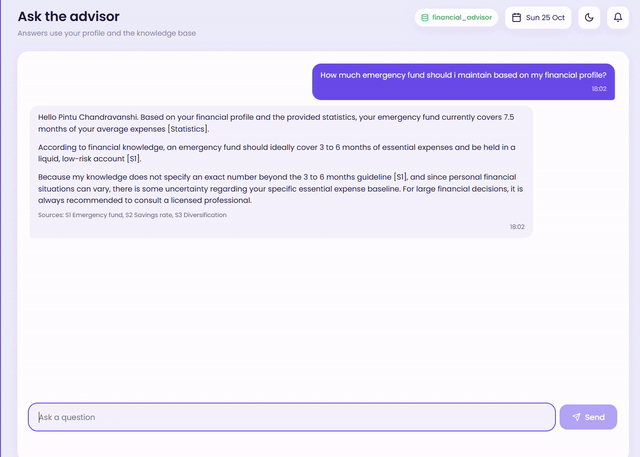

# AI Financial Advisor

A household finance dashboard and AI chat assistant built with React, FastAPI, MySQL, and Google's Gemini API. The assistant uses retrieval-augmented generation (RAG): it retrieves relevant saved knowledge and combines it with the user's profile and calculated financial statistics when answering. No model is trained by this project.

## Features

- Financial profile onboarding and dashboard metrics
- Gemini-powered financial Q&A with retrieved knowledge and source labels
- Saved chat history and conversation analytics
- Optional monthly expense history, including missing months
- XAMPP/MySQL support, with a local SQLite fallback if MySQL is unavailable

## Project layout

```text
Backend/
  main.py
  requirements.txt
  .env.example
Frontend/
  index.html
  package.json
  public/icon.png
  src/
demo-video.mp4
README.md
```

## Requirements

- Python 3.10 or newer
- Node.js 18 or newer and npm
- A Gemini API key
- MySQL (optional; XAMPP can provide it). If MySQL is unavailable, the backend falls back to a local SQLite database.

## Configure the backend

In phpMyAdmin or a MySQL client, create the database used in the example configuration:

```sql
CREATE DATABASE financial_advisor CHARACTER SET utf8mb4;
```

In PowerShell:

```powershell
cd "Backend"
Copy-Item .env.example .env
```

Edit `Backend/.env` and set `GEMINI_API_KEY`. Set `DATABASE_URL` to match your MySQL username, password, host, port, and database. For a default XAMPP root account with an empty password:

```dotenv
DATABASE_URL=mysql+pymysql://root:@localhost:3306/financial_advisor
```

The `.env` file contains secrets and is excluded from Git. Do not commit it. The model identifiers are configurable using `GEMINI_MODEL` and `EMBED_MODEL`.

Install and start the backend:

```powershell
cd "Backend"
python -m venv .venv
.\.venv\Scripts\python.exe -m pip install -r requirements.txt
.\.venv\Scripts\python.exe -m uvicorn main:app --reload --host 127.0.0.1 --port 8000
```

The API documentation is available at <http://127.0.0.1:8000/docs>.

## Start the frontend

Open another PowerShell terminal:

```powershell
cd "Frontend"
npm install
npm run dev
```

Open the Vite URL printed in the terminal, usually <http://localhost:5173>. Keep both development servers running while using the app. Start MySQL in XAMPP if using MySQL.

## API overview

- `GET /health` reports backend/database status.
- `POST /profile` saves a financial profile.
- `GET /profile/{user_id}` retrieves a profile.
- `POST /chat` sends a question to Gemini and returns an answer with sources.
- `GET /history/{user_id}` retrieves that user's saved messages.
- `GET /analytics/conversations` returns conversation summaries and analytics.
- `POST /ingest` adds knowledge text to the RAG index.

Tables are created automatically. Starter financial notes are embedded and added when the knowledge table is empty; a working Gemini API key is needed for embeddings and chat.

## Add knowledge

Send text to the backend's `/ingest` endpoint with a source label. For example, from PowerShell:

```powershell
$body = @{ source = "My finance notes"; text = "Add your finance guidance here." } | ConvertTo-Json
Invoke-RestMethod -Uri "http://127.0.0.1:8000/ingest" -Method Post -ContentType "application/json" -Body $body
```

## Demo video



[Watch or download the full demo video](demo-video.mp4).

## Privacy and security

- Never commit `.env`, API keys, database files, or real financial/profile data.
- Use fictional data when demonstrating the app publicly.
- The app stores profile and conversation information in its configured database. Do not expose a database containing real user data.
